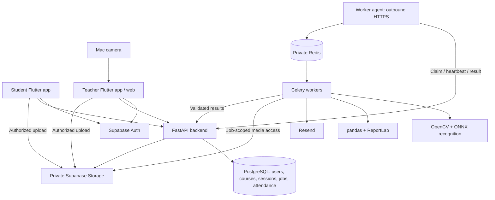

# FaceTrack — Development Master Design

**Version 2.3 · 27 October 2026 · Asia/Kolkata**

**Goal:** a stable, functional demonstration by **28 October 2026**, followed by a supervised institute pilot. This document is the active implementation specification. Production readiness and measured performance remain release gates, not claims about existing software.

The agreed technology stack is unchanged. This revision removes repeated explanations, extensive alternative analyses, speculative infrastructure, and optional product features from the implementation path. This is the only active design document; the superseded unfinished draft was removed at the user's request. Read `AGENTS.md` for project instructions and `PROGRESS.md` for the current development checkpoint.

The iPhone beta extends the existing Student and Teacher Flutter products. It uses separate app IDs and the existing hosted HTTPS API, attendance and consent flows. TestFlight distribution requires signed builds and physical iPhone verification of both capture workflows.

## Contents

1. [Scope and decisions](#1-scope-and-decisions)
2. [High-level design](#2-high-level-design)
3. [Code structure](#3-code-structure)
4. [Data model](#4-data-model)
5. [Lifecycle and attendance rules](#5-lifecycle-and-attendance-rules)
6. [API contracts](#6-api-contracts)
7. [Camera and media pipeline](#7-camera-and-media-pipeline)
8. [ML pipeline](#8-ml-pipeline)
9. [Reliable processing](#9-reliable-processing)
10. [Timetable integration](#10-timetable-integration)
11. [Reports and faculty delivery](#11-reports-and-faculty-delivery)
12. [Security and privacy](#12-security-and-privacy)
13. [Deployment and operations](#13-deployment-and-operations)
14. [Tests and release gates](#14-tests-and-release-gates)
15. [Build sequence and milestones](#15-build-sequence-and-milestones)
16. [Research basis and deferred work](#16-research-basis-and-deferred-work)

## 1. Scope and decisions

### Deliver for the demonstration

- Separate Student and Teacher Flutter apps with shared code. Both run on Android and web.
- Sign-in with provisioned accounts, verified linkage to an approved roster, consent, and a guided front/up/down/left/right enrolment video.
- Face-template generation, supervised activation, and storage linked to the correct student.
- Courses, rosters, sessions, and a basic structured CSV timetable upload with preview/confirmation.
- Teacher camera capture, actual recognition, visible progress, provisional attendance, teacher correction and publication.
- Persisted student attendance, downloadable CSV/PDF reports, and faculty email delivery within configured provider permissions.
- Recovery from a worker restart, duplicate upload completion, and retried jobs.

A demonstration must use actual capture, inference, and persisted records. Test mocks may not be presented as measured recognition. If any feature slips, explicitly label the missing feature; do not describe the milestone as complete.

### Assumptions

| Dimension | Demonstration | Future sizing assumption |
|---|---|---|
| Students | 20–50 consenting adult volunteers | 5,000; growth case 20,000 |
| Students visible per capture | Start with 10–30 | Typical class 60; test up to 100 |
| Concurrent classes | 1–2 real capture flows | 20 simultaneous uploads |
| Concurrent app users | 10–30 | 500 |
| Daily sessions | A few rehearsals | 20 rooms × 8 = 160 |
| Classroom video | Prefer 5–15 seconds, no audio | Maximum 30 seconds |
| Enrolment video | Guided 10–20 seconds | Maximum 30 seconds |
| Cost | Target ₹0 incremental using existing equipment and free tiers | Institute funds always-on services; CPU-only estimates ≈ $44–$290/month by size (`docs/COST_AND_RELIABILITY.md`), excluding the unpriced model licence |

These are planning assumptions, not measured institute facts. Verified development baseline: Apple M4 with 16 GB RAM and a working Mac-camera recording path. Classroom coverage, uplink and concurrent processing capacity remain unmeasured.

### Fixed decisions and reasons

| Decision | Reason |
|---|---|
| Flutter + Dart | Retains the agreed stack and shares logic across the two apps and teacher web |
| Python + FastAPI | Typed API contracts and one language for backend/ML integration |
| Supabase Auth + PostgreSQL + private Storage | One managed platform; relational constraints suit sessions and attendance |
| OpenCV + FFmpeg + SCRFD/ArcFace-family ONNX models | Separate decoding, detection and recognition; benchmark model variants rather than training from scratch |
| Redis + Celery | Background execution isolated from HTTP requests |
| PostgreSQL is authoritative | Redis loss or worker retries cannot erase attendance or job state |
| Exact, roster-scoped cosine matching | Tens of identities per class do not require an approximate vector index |
| Human-reviewed publication | A usable scan suggests Present or Absent. Only a teacher may publish. |
| CPU worker for local and Azure demo profiles | Supports minimal cost while retaining the same processing interface; Runpod/GPU stays optional after measurement |
| CSV timetable first | Deterministic import; PDF/OCR and ERP integration can feed the same normalized model later |

Retain pandas/openpyxl, ReportLab, Resend and Docker. Sentry and GitHub Actions remain planned operational work and are not present in the repository. No React rewrite, MongoDB/Firebase Auth migration, Kubernetes or new message platform.

## 2. High-level design



**Backend:** one modular application, not a collection of microservices. It owns authorization, sessions, durable jobs, attendance and reports. ML runs in a separate process so inference cannot block ordinary app requests.

**Student flow:** register → claim approved identity → enter teacher join code → pending course request → teacher approval. Separately: consent → record poses → upload → generate templates → supervised biometric approval. Both approvals are required for recognition eligibility; only published own attendance is visible.

**Teacher flow:** institute provisions faculty profile/account and membership → assigned offerings → share join code → approve requests → upload timetable → confirm sessions → open session → capture class → upload → process → review suggestions → finalize → download/receive report.

**Background flow:** API saves job → worker claims it → Celery executes → API validates result → transaction stores evidence/attendance → report and delivery jobs follow.

The worker agent is a small module, not another hosted service. It lets the Mac fetch work without exposing Redis or opening inbound laptop ports. Later the same worker group moves to cloud infrastructure.

### Planned demo versus institute deployment

| Component | Demo placement | Institute pilot |
|---|---|---|
| Auth/database/files | Supabase free project | Funded plan with tested backups |
| API | Local Mac process or canonical Docker container | Always-on application host selected after pilot measurements |
| Teacher/Student web | Flutter development servers on localhost | Static HTTPS hosting on institute domain |
| Redis/Celery/ML | Existing Mac; CPU baseline | Persistent CPU worker group on one always-on server (AWS Mumbai estimated); GPU is not required at the measured 356 ms pipeline time and is reconsidered only if benchmarks or continuous camera streaming demand it |
| Reports/email | Worker group on Mac | Always-on CPU worker group |

Supabase hosts Auth, PostgreSQL and private Storage. The Azure demo serves both web apps over HTTPS and runs FastAPI, Redis, the agent and CPU inference on one VM. The local development profile runs the services on the development machine, with USB forwarding for Android debug builds. Windows uses native Flutter and Linux containers for the backend. Institute operation still requires model rights, capacity and recovery validation.

## 3. Code structure

The tree below is the implemented repository structure. The API is a modular monolith whose domains are split across modules rather than directory-per-domain routers. The worker and agent are separate processes but share one locked worker package.

```text
apps/student/                  Flutter student entrypoint
apps/teacher/                  Flutter teacher, spike and test-console entrypoints
packages/app_core/             auth, API client, errors, theme
packages/domain_models/        typed DTOs shared by apps
packages/capture/              Android/web camera, guidance, playback and TUS upload
services/api/app/              FastAPI auth, academics, biometrics, attendance and documents
services/api/migrations/       Alembic 0001–0008 and immutable SQL snapshots
services/api/tools/            local DB, Supabase, seed, Storage and smoke utilities
services/worker/src/facetrack_worker/
  agent.py                     claim/heartbeat/dispatch and reconciliation loop
  executor.py                  Celery task, media integrity and child-process isolation
  inference.py                 enrolment, recognition, timetable and report adapters
  console.py                   loopback-only volunteer model-test service
services/worker/src/facetrack_ml/  frozen decoding/detection/alignment/matching pipeline
experiments/ml_accuracy/       isolated, non-production candidate evaluation
docker/                        API and worker Linux container definitions
compose.yaml                   canonical local API/Redis/worker/agent stack
scripts/                       setup, camera spike, console, freeze and evaluation tools
contracts/                     generated OpenAPI and fixtures
tests/                         root ML contract and synthetic media tests
MASTER_DESIGN.md                active specification
```

Flutter: Riverpod controllers/view models, repositories, `go_router`, `dio`, `supabase_flutter`, `camera`, `file_picker`, secure native token storage. Keep platform camera code behind an adapter; do not duplicate business rules between apps.

Backend: Python 3.11, Pydantic 2, SQLAlchemy 2, psycopg 3, Alembic, pytest and Ruff. Exact resolutions are committed in the three `uv.lock` files. Routes validate requests and call transactional services; no inference or durable work runs in FastAPI `BackgroundTasks`. Product ML stays in the frozen root package; API and worker dependencies stay in their own environments.

Generated OpenAPI describes implemented routes only; future routes below are contracts for later feature slices. Package documentation helps implementation, but may not silently change product behavior.

### Phase 3A: approved Flutter implementation specification

Student and teacher are separate Flutter applications, each delivered for Android and web. Administration is an **Admin** tab inside the Teacher app (web and Android), shown only to accounts with an active admin membership. Controlled-account login, identity linkage, class requests, faculty class creation, join codes, approval, biometric enrolment, session review, timetable import and report screens are implemented in source. Their real-device and classroom acceptance is tracked separately in PROGRESS; public registration and recovery follow later.

Use shared `app_core` (auth, API client, adaptive theme/controls) and `domain_models` packages with path dependencies; retain role-specific screens in each application. Riverpod, go_router, Dio and stable supabase_flutter 2.18.3 are fixed. Persist Android sessions in secure storage; web uses SDK-compatible browser persistence with app-specific storage keys. Sessions/requests/caches are invalidated on logout/account change; JWT metadata cannot grant roles. After auth restoration fetch `/v1/me`, derive profile/membership access, and select only an eligible institute. Unlinked students claim against the public configured demo institute ID; there is no public institute directory.

Classes and Account are the two main destinations. Student classes show their own pending/active/rejected/withdrawn enrolments and a join-code form. Teacher classes show assigned offerings, creation from approved academic lookups, join-code copy/rotation and Requests/Students detail tabs. Approval requires confirmation; rejection requires a reason. Every list/form has loading, empty, error and permission states. Refresh on route entry, resume, mutation and explicit request. Keep idempotency keys on retries; stale writes refresh and require new confirmation.

Visual system: Material 3 with deep teal-to-green branded headers, pale neutral background, white content surfaces, restrained mint accents, 16/24/32 spacing and rounded cards. Class cards use a slim accent band; status colors retain semantic meaning. Sign-in uses a compact brand banner on phones and a two-column brand/form layout on wide screens. Loading, empty and populated states use short reduced-motion-aware transitions. Bottom navigation remains on narrow screens and a rail on wide screens. Resource-specific class/session routes must reset screen state when their ID changes. Teacher session navigation warns before discarding unsaved attendance choices; saving remains explicit. Persistent field labels, password visibility, keyboard focus/semantics, 48px controls and large-text layouts are acceptance checks. Decorative elements carry no attendance or recognition meaning; do not invent statistics or nonfunctional feature buttons.

Add `/v1/me/enrollments` with own-account derivation and keyset pagination, returning enrolment state/version and a limited offering summary even for rejected/withdrawn history. Add course/term/group labels to offering summaries and optional status filtering before pagination on the faculty roster route. Core database schema remains unchanged. Regenerate OpenAPI and typed Dart contracts with these read additions.

Keep existing local camera app on a separate `main_spike.dart` entrypoint; do not alter frozen ML files. Teacher web uses localhost:5300; student web localhost:5301; spike localhost:5302. CORS permits the exact product origins. Android IDs are dev.facetrack.student and dev.facetrack.teacher. Use installed Flutter and JDK17, Android SDK36/minSDK24 and generated compatible Gradle tooling; native verification uses the user's USB-connected phone, not an emulator. `adb reverse tcp:8000 tcp:8000` reaches the Mac API; localhost HTTP is allowed only for debug Android builds, release endpoints require HTTPS. Public Flutter config contains only API/Supabase URLs, publishable key and demo institute ID. Signed release APKs use the HTTPS Azure API. Follow the [installation guide](docs/INSTALLATION.md) for local debug and the [Azure guide](docs/DEPLOY_AZURE.md) for release builds.

## 4. Data model

### Conventions

Every tenant table has `id uuid`, `institute_id uuid`, `created_at timestamptz`, `updated_at timestamptz`, and unique `(institute_id,id)`. `institutes` itself has no parent institute ID. All relationships between tenant entities use composite tenant/ID foreign keys. Auth user IDs reference Supabase Auth; role and course authorization remain backend-owned.

Use UTC instants, Asia/Kolkata display timezone, text enrolment numbers preserving leading zeros, constrained status values, and integer versions for optimistic locking. Fields marked `?` are nullable. Store media in private object storage, not database base64. JSON is permitted for immutable snapshots, quality summaries and manifests, not as a replacement for core foreign keys.

### Implemented foundation (Phase 2)

All tables below exist in migrations `0001_foundation` and `0002_private_grants`. Supabase owns `auth.users`; application migrations never create or modify its schema. Local tests use a deliberately limited relational fixture, not an Auth server.

| Table | Required business fields | Integrity |
|---|---|---|
| `institutes` | name, timezone, status | Active/suspended; no parent institute |
| `memberships` | auth_user_id, role, status | Unique tenant/user/role; student/teacher/admin; pending/active/suspended; profiles alone grant no permissions |
| `students` | auth_user_id?, enrollment_number, official_name, official_email, status, template_epoch | Unique tenant/number, tenant/email, tenant/linked account; preserve leading zeros; approved/suspended/archived |
| `teachers` | auth_user_id?, employee_number, official_name, official_email, status | Same identity rules; stable faculty ID survives login unlinking |
| `terms` | code, starts_on, ends_on, schedule_revision | Unique tenant/code; ordered dates |
| `courses` | code, title, status | Subject definition; unique tenant/code; active/archived |
| `class_groups` | term_id, branch, semester, section | Unique tenant/term/branch/semester/section; semester 1–20 |
| `offerings` | course_id, term_id, class_group_id, title, status, roster_version | Unique tenant/group/course; composite FK enforces group's term equals offering's term; active/archived |
| `offering_teachers` | offering_id, teacher_id, can_finalize, status | Unique tenant/offering/teacher; active/inactive; insert/activation trigger requires approved linked faculty and active teacher membership |
| `offering_join_codes` | offering_id, code_hash, ciphertext, nonce, key_id, expires_at, revoked_at? | Globally unique SHA-256 code digest; AES-256-GCM recoverable code; one unrevoked code/offering; unique key/nonce |
| `course_enrollments` | offering_id, student_id, status, effective_from, effective_until?, approved_by?, reason? | Unique tenant/offering/student; requested/active/rejected/withdrawn; only active records are attendance-eligible |
| `audit_events` | actor_id?, action, resource_type, resource_id?, request_id, summary | Append-only runtime grants; no biometric material or request secrets |
| `idempotency_records` | actor_id, route, key, request_hash, response_status, response_json, expires_at | Unique tenant/actor/route/key; 24h; clear join codes never stored in replay payload |
| `rate_limit_windows` | actor_id, action, window_start, attempts | Unique tenant/actor/action/window; ten fresh code attempts per ten-minute window, persisted even on invalid-code response |

Every tenant table above has `version`; institutes has timestamps but no optimistic version. Student branch/semester/section are represented by term-specific class groups and offering enrolments, not duplicated profile fields. A course is a subject; a group is a term's branch/semester/section; an offering links them. A room is a physical location and is a separate later model.

Approved course enrolment is the source of offering access. Entering a code grants only a request and limited visibility of that offering's summary. It grants no roster visibility, biometric access or attendance eligibility. Students have no institute-wide course catalogue. Rejected/withdrawn students contact faculty; entering another code cannot reactivate them. Active enrolment's effective start is set on approval/reactivation. Frozen session rosters preserve historical membership when a current enrolment changes.

The Teacher subject list requests the active roster filter. That view requires current subject approval and an active, faculty-approved face enrolment with consent and three to five templates for the current recognition profile. Pending face reviews use a separate endpoint. New sessions freeze only students who meet both subject and face enrolment requirements. The pending-face roster filter lists subject-approved students without compatible active face enrolment. Existing session rosters and publications retain their historical membership.

Codes use 12 random characters from a human-readable alphabet, displayed as three groups, and expire after seven days or term end, whichever comes first. Lookup ignores spaces/hyphens/case. Rotation and requests lock the offering and revalidate the code to avoid races. Teacher retrieval/replay rechecks current assignment; rotated/expired code replay returns conflict. Encryption associated data binds institute/offering/code ID. Keep old key versions until their remaining codes expire or are rotated. No code in logs, audit summaries or idempotency JSON.

Demo bootstrap uses controlled, already-confirmed Supabase accounts. An owner-only seed tool checks actual Auth IDs/emails, provisions approved faculty/student records, active teacher memberships and academic assignments. It cannot overwrite existing identity links. Student claims compare enrolment number with the **current confirmed email fetched from Supabase Auth**, ignoring user-editable metadata and stale JWT email. Teacher/admin roles are provisioned; public signup cannot request them. Suspend memberships/profiles instead of deleting academic history.

### Feature tables and staged implementation

The nine biometric/media/model/job/worker tables below are implemented in migrations 0003/0004. Migration 0005 implements six session, roster, capture, evidence, attendance and publication tables. Migration 0006 implements seven room, timetable and report/delivery tables. Migration 0007 adds evidence-coded absence proposals and the tenant-scoped attendance-dispute table. Migration 0008 adds no tables: it adds the `app.is_admin()` predicate, admin write policies and `app.admin_*` SECURITY DEFINER provisioning functions. All migrations through `0008_admin` are applied to the development database: **37 business tables with forced RLS**. Schema state does not itself verify real classroom acceptance.

| Table | Required business fields | Integrity |
|---|---|---|
| `rooms` | code, name, capacity | Unique tenant/code; physical room independent of class group |
| `recognition_profiles` | model_release_id, settings_json, settings_hash, evaluation_hash?, status | Immutable quality/sampling/matching/consistency settings; unique model/settings hash |
| `consents` | student_id, notice_version, notice_hash, accepted_at, withdrawn_at? | Append-only acceptance; revocation blocks matching |
| `model_releases` | manifest_json, manifest_hash, license_status, evaluation_status, status | Hash immutable; never mix incompatible model releases |
| `enrollment_attempts` | student_id, consent_id, asset_id, model_release_id, recognition_profile_id, pose_order, challenge_hash, status, generation, reviewed_by?, quality_json, version | One unfinished attempt/student; generation defaults 1 |
| `template_sets` | student_id, attempt_id, model_release_id, recognition_profile_id, status, activated_at?, revoked_at?, set_version | One active set/student/model; 3–5 templates/set |
| `face_templates` | template_set_id, pose, ordinal, ciphertext, nonce, key_id, dimension, preprocess_version | Unique set/ordinal; 512D for chosen profile; unique encryption nonce/key |
| `media_assets` | owner_user_id, purpose, bucket, object_key, mime_type, byte_size?, sha256?, expires_at, status | Unique bucket/key; purpose enrollment/classroom/timetable/report |
| `sessions` | offering_id, series_id?, occurrence_key, teacher_id, room_id?, starts_at, ends_at, capture_closes_at, status, policy_version, model_release_id, recognition_profile_id, version, attendance_revision | Unique tenant/occurrence_key; end > start |
| `session_roster` | session_id, student_id, name_snapshot, enrollment_number_snapshot, template_set_id?, template_epoch, recognition_eligible | Unique session/student; frozen when session opens |
| `captures` | session_id, asset_id, submitted_by, source_type, recorded_at, status, generation, model_release_id, recognition_profile_id, roster_hash, quality_json, version | Multiple captures/session; generation independent of UI version |
| `jobs` | kind, enrollment_attempt_id?, capture_id?, timetable_import_id?, template_set_id?, media_asset_id?, report_id?, delivery_id?, generation, dedup_key, payload_json, state, stage, attempts, available_at, lease_owner?, lease_epoch, lease_expires_at?, result_hash?, error_code? | Unique tenant/dedup_key; kind-specific exactly-one resource FK; no tokens/media/vectors in payload |
| `worker_identities` | token_hash, allowed_kinds, allowed_model_hashes, status, expires_at, last_seen_at? | Scoped worker credentials; no public self-registration |
| `recognition_evidence` | session_id, capture_id, student_id, template_set_id, template_epoch, track_key, accepted_hits, span_ms, scores_json, decision, job_id | Unique capture/student/track; same-tenant/session roster and template/student composite FKs; no permanent crops |
| `attendance_records` | session_id, student_id, status, source, evidence_id?, manual_lock, reason?, modified_by?, version | Unique session/student; FK to frozen session_roster; evidence FK includes tenant/session/student |
| `publications` | session_id, revision, snapshot_json, snapshot_hash, published_by, published_at, reason? | Unique session/revision; immutable |
| `reports` | offering_id, session_id?, publication_id?, kind, source_version, snapshot_json, snapshot_hash, status, csv_asset_id?, pdf_asset_id?, expires_at | Session reports unique tenant/session/kind/source_version; final reports unique publication/kind; cumulative unique offering/kind/snapshot_hash |
| `deliveries` | report_id, recipient_user_id, channel, dedup_key, status, provider_message_id?, attempts, delivered_at? | Unique dedup_key; recipient resolved by backend |

`model_releases` pins weights, preprocessing, dimensions and permitted use. `recognition_profiles` pins experimental matching/quality settings separately. Activated template sets and each recognition run pin both versions; a settings change cannot reinterpret existing evidence. Record any experimental parent/selection provenance without mutating prior settings.

Jobs use explicit nullable resource columns with composite FKs and a kind-dependent exactly-one check; JSON UUIDs cannot establish ownership. Evidence must match the same institute/session/student as the attendance row, and its template set must belong to that student. Revoke/delete biometric payloads while retaining non-biometric historical identifiers required by attendance. Stable teacher references belong in teaching assignments, schedules and sessions, independent of Auth account lifecycle.

Schedule/import contracts are in §10. Report deduplication includes the actual session/publication identity, so two sessions at revision 1 never collide. Biometric review requires an active institute role and a valid relationship to that student; being a teacher alone grants no institute-wide template access.

### Indexes and transactions

Index sessions by `(institute_id,status,starts_at)`; attendance by `(institute_id,student_id,session_id)`; jobs by `(institute_id,state,available_at)` and active lease expiry; media by expires_at; offering_teachers by teacher; template sets by student/status. Unique keys above also require indexes.

Lock session before attendance mutation; lock student before template activation/revocation. Consistently order multi-row locks. Publication, attendance updates, audit and follow-up jobs commit together. A scheduler inserts durable jobs in the same transaction as its transition. No external email inside a DB transaction.

`version` changes on user-visible mutation. `generation` changes only on an explicit new processing run. A job's generation is fixed across progress/state updates: starting processing must not accidentally invalidate its own result. Retry infrastructure failures within the same generation; new input or a deliberate rerun starts a new generation.

## 5. Lifecycle and attendance rules

### Sessions

`scheduled → open → closed → review_required → finalized`

Branches: scheduled/open → cancelled; closed → no_data when no usable evidence/manual assessment exists; no_data → review_required after teacher action. Finalized corrections create revision N+1; they do not reopen the session or overwrite old publications.

At open, freeze eligible course members with approved compatible face enrolment in `session_roster` and initialize attendance rows as unresolved. Later course or section changes cannot rewrite historical rosters. Already accepted processing can finish after close. Finalization requires settled recognition jobs.

### Enrolment

`awaiting_upload → queued → processing → review_required → active`

Rejected/failed attempts show actionable reasons and permit a new attempt. Approval is a supervised teacher/admin action for the demo. Activating a new set atomically revokes the previous compatible set and increments template_epoch. Consent withdrawal immediately blocks future matching and queues biometric deletion.

### Attendance

New attendance decisions and publications use **Present** or **Absent** only. The Teacher review shows one choice per frozen approved roster member. The API rejects publication while any member lacks a final mark or recognition is still processing.

- The API records Present evidence for corroborated matches and proposes absence for remaining approved students after usable footage. The Teacher review preselects Present for matches and Absent for other unresolved rows when processing produces a result, including limited footage. A failed scan alone or no recording result requires manual marks. The teacher can change any draft mark and publish once processing settles.
- Later usable clips can add Present suggestions. Limited clips cannot erase earlier evidence or draft absence. A manual mark is locked against recognition updates.
- Corrections require a reason, actor, expected version and a new immutable revision. Older publications remain historical. Corrections and accepted disputes return `REVIEW_REQUIRED` if the resulting publication would retain any nonbinary legacy mark. Legacy late counts as Present. Unmarked historical entries are excluded from current student attendance views.
- Match only students on the frozen roster with current consent and compatible templates.

**Percentage policy `session-v1`.** Divide published Present marks (including legacy late) by published Present plus Absent. Older records without a binary mark, cancelled sessions and unpublished sessions are excluded. When there are no marks, the percentage is null. One clip establishes observed presence at capture time.

## 6. API contracts

### Shared conventions

Base `/v1`; authenticated user JWT except public privacy notice. Verify ES256 signature with the configured project's fixed `/auth/v1/.well-known/jwks.json`, issuer `/auth/v1`, audience/role authenticated, exp/iat/sub, UUID subject and non-anonymous account. HS256, service-role tokens and user-supplied key URLs are rejected. Cache public keys five minutes, throttle unknown-key refreshes to 30 seconds; provider failure returns retryable 503. A Supabase signing-algorithm change requires explicit review, not a silent fallback. `X-Institute-ID` selects a membership already authorized by the server; it grants nothing by itself.

Use snake_case JSON, UUID strings, UTC RFC3339 timestamps. Reject unexpected fields. Lists use keyset pagination, default 50/max 200. Async actions return 202 `{job_id,resource_id,state,status_url}`. Ordinary creates return 201. Reads return resource version; changing an existing resource requires `If-Match` with that integer version. Stale update → 409.

Mutation POSTs accept `Idempotency-Key`: same actor/route/key/body returns original result; different body gives 409. Save completion atomically with domain mutation. Re-authorize and remint any signed media grant rather than storing it in an idempotency response.

Errors: `{error:{code,message,request_id,retryable,details}}`. Use 401 authentication, 403 disallowed action, 404 inaccessible/missing object, 409 state/version conflict, 413 size, 415 media, 422 validation, 429 quota, 503 dependency outage. Never return database/stack details.

Admin creates a class group from term, branch and semester. The API supplies
the internal default group key when no legacy section is specified. Faculty
provisioning uses official email as the unique identity within the institute.
The API supplies a stable internal value for the legacy employee-number column
when a caller omits it. Existing labelled groups, faculty profiles, and student
enrolment numbers retain their identifiers.

### Initial endpoints

| Routes | Contract and permission |
|---|---|
| `GET /me` | Own linked student/teacher profiles and memberships; no client role/enrolment change |
| `GET /me/enrollments` | Own institute-scoped requested/active/rejected/withdrawn enrolments, with labelled offering summary; keyset pagination, verified student derived server-side |
| `GET /academics/{courses\|terms\|class-groups}` | Approved faculty/admin lookup only; keyset pagination |
| `POST /identity/claim` | `{enrollment_number}`; exact approved verified-email match; admin resolves mismatches |
| `GET /offerings`, `POST /offerings`, `GET /offerings/{id}` | Own memberships/assigned courses; teacher create `{course_id,term_id,class_group_id,teacher_id?}` validates same-tenant term/group; teacher may assign self, admin may assign other approved faculty |
| `GET /offerings/{id}/join-code`, `POST /offerings/{id}/join-code` | Assigned teacher/admin retrieves or creates/rotates code; POST requires Idempotency-Key and offering If-Match |
| `POST /enrollment-requests` | `{join_code}`; verified linked student derived from JWT; creates requested membership, never immediate approval |
| `GET /offerings/{id}/roster`, `PATCH /offerings/{id}/enrollments/{id}` | Assigned teacher only; optional roster status filter before pagination; approve/reject/withdraw with reason |
| `GET /privacy/notice`, `POST /consents`, `DELETE /consents/{id}` | Versioned notice; explicit own acceptance/revocation |
| `POST /biometric-enrollments` | `{consent_id,mime_type,expected_bytes}` → challenge, pose order, asset/grant |
| `POST /biometric-enrollments/{id}/upload-complete` | `{asset_id,byte_size,sha256}` → durable processing job |
| `GET /biometric-enrollments/{id}`, `POST /biometric-enrollments/{id}/approve` | Owner sees status; teacher/admin supervises activation |
| `GET /sessions`, `POST /sessions`, `GET /sessions/{id}` | Authorized lists/detail; ad-hoc teacher creation with offering/start/end/room |
| `POST /sessions/{id}/open`, `/close`, `/cancel` | Assigned teacher, valid state/window, If-Match; cancellation requires reason |
| `POST /sessions/{id}/captures` | `{source_type,recorded_at,mime_type,expected_bytes}` → capture/asset/upload grant |
| `POST /captures/{id}/upload-complete`, `GET /captures/{id}` | Scoped upload completion and status; duplicate completion returns same job |
| `GET /jobs/{id}` | Owner/authorized teacher sees stage, state and sanitized errors |
| `GET /sessions/{id}/attendance` | Assigned teacher sees roster; students use own attendance route |
| `PUT /sessions/{id}/attendance-review` | `{decisions:[{student_id,status,reason?}]}`; manual locks; If-Match |
| `POST /sessions/{id}/finalize` | Present/Absent for the entire roster, all recognition jobs settled; publish + report job |
| `POST /sessions/{id}/corrections` | `{student_id,status,reason,publication_revision}`; new revision |
| `GET /me/attendance` | Own published history and summary. Order by session start and stable session ID. Publication UUID cursors resolve to their session and remain valid after corrections. |
| `POST /media-reservations` | Purpose timetable + upload metadata; teacher/admin only |
| `POST /timetable-imports`, `GET /timetable-imports/{id}` | `{asset_id,term_id,base_revision,byte_size,sha256}` → validation job/preview. Recheck faculty access and reservation ownership and purpose after Storage verification. |
| `POST /timetable-imports/{id}/commit` | `{preview_hash,expected_revision}` → atomic schedule update |
| `GET /reports/{id}`, `GET /reports/{id}/download?format=csv\|pdf` | Assigned teacher; authorized short-lived download |
| `POST /reports/{id}/deliveries` | No arbitrary address; backend resolves verified faculty recipient |

Validation: display names ≤100 chars, titles ≤150, enrolment IDs ≤32, reasons ≤500, semester 1–20; maximum 500 decisions/request. A request cannot set model scores or submit a trusted `present=true` outside the teacher decision schema.

Foundation, privacy, biometrics and enrolment job routes are implemented. Sessions, classroom jobs, attendance, timetable and reports are the next authorized slices. `/health/live` and `/health/ready` are unauthenticated, sanitized operational endpoints. Full foundation field types and error envelopes are generated in `contracts/openapi.json`; `PATCH /me` is deferred.

### Internal worker API

Prefix `/internal/v1`, TLS, no browser CORS, revocable random worker token stored hashed. User JWTs cannot invoke it. Worker credentials are scoped to institute, job kinds and model hashes, expire within 30 days and are provisioned privately.

- `POST /jobs/claim`: capabilities + free_slots → leased jobs or 204.
- `POST /jobs/{id}/start`: epoch → running.
- `POST /jobs/{id}/heartbeat`: epoch/stage → lease renewal.
- `GET /jobs/{id}/input`: epoch → scoped media/template/report input.
- `POST /jobs/{id}/complete`: epoch/generation/result_hash/typed result → atomic validated commit.
- `POST /jobs/{id}/fail`: epoch/code/retryable → retry or failed.
- `POST /scheduler/tick`: authorized scheduler capability, server-owned current time.
- `POST /maintenance/reconcile`: expired leases/uploads/retention, bounded batch.

Recognition results contain capture/model/roster hash and evidence `{student_id,template_set_id,template_epoch,track_key,hits,span_ms,scores,decision}`. Enrolment results contain attempt/model/quality and `{pose,ordinal,vector}` templates; API validates/encrypts immediately. Report results reference the preallocated assets and hashes. Job input/result bodies ≤5MiB; never log them.

## 7. Camera and media pipeline

Android uses the Flutter camera adapter. The Teacher web classroom scanner uses browser media APIs on **HTTPS or localhost**. Chrome is the primary web test target. Test permission denial, app pause/resume, camera already in use, orientation and actual recorded codec. Audio is off.

Student and Teacher Android use CameraX and local ML Kit analysis. When simultaneous recording and analysis make CameraX deliver an already rotated portrait buffer, the shared preview bypasses the plugin's sensor transform only if the surface does not handle rotation itself. The overlay fits the native buffer dimensions. Both signed APKs use shared rules that preserve the ML Kit registrar constructors Android discovers through reflection. Maintain these safeguards and validate changes using the signed camera checks for [Student](docs/CAMERA_VALIDATION.md#student-android-signed-release-check) and [Teacher](docs/CAMERA_VALIDATION.md#teacher-android-signed-release-check).

One Mac camera gives one viewpoint. It cannot demonstrate 20 physical rooms or guarantee back-row recognition. Digital zoom cannot recover missing face detail. Begin with nearby volunteers, then test real classroom coverage before buying/recommending cameras.

| Input | Limit |
|---|---|
| Enrolment clip | 30s / 25MiB |
| Class clip | 25 MiB per segment; see [camera validation](docs/CAMERA_VALIDATION.md) for capture timing and device checks |
| CSV/XLSX timetable | 5MiB / 2,000 rows |
| Video profile | MP4/H.264 or WebM/VP8/VP9; ≤1080p, bounded decode frame/pixel/time budget |

API generates an opaque object key and restricted upload grant. Client uploads directly to private Supabase Storage, then calls upload-complete. Server checks expected object metadata; worker recomputes digest and validates actual container/duration/decoded dimensions before inference. Large files use authenticated resumable uploads; storage policies restrict them to the exact owner reservation. No client-supplied arbitrary URL or filename is used for worker downloads.

Run patched FFmpeg/FFprobe non-root with bounded resources, no remote protocols, isolated per-job temporary directory, and argument arrays rather than shell commands. Clear temporary clips/frames in success and failure paths. Invalid media fails with a reason; infrastructure retries cannot fix bad input.

Grant expiry is independently bounded by application reservation expiry; provider token lifetimes may differ. Rejected/expired/orphan objects are cleaned up. No public media bucket or embedding download API. A student's own phone may retain an explicitly pending retry clip privately for ≤24h; delete it on success/cancel. Do not silently cache classroom footage or templates.

## 8. ML pipeline

### Enrolment

1. Verify roster linkage and explicit consent.
2. Issue a short-lived challenge: front first, remaining four poses shuffled; guide moderate tilts/turns rather than extreme profiles.
3. Record, upload, sample up to 100 frames at up to 5fps.
4. Detect one consistent face; reject sustained second faces, severe blur, inadequate pixels and inconsistent identity.
5. Align faces and generate normalized embeddings; retain 3–10 quality templates, preferably about five, with front and multiple pose coverage.
6. Teacher/admin confirms identity and pose coverage before activation. Automated pose verification may be added only after validation; do not fabricate exact yaw/pitch from five landmarks.
7. Activate atomically, encrypt templates and remove raw clip according to retention.

Pose challenge and ordinary RGB video are **not certified liveness**. Supervision is the initial identity assurance mechanism; photo/replay/injection attacks remain relevant.

### Classroom recognition

`video → sample frames → detect faces → quality filter → align → batch embeddings → roster-only matching → temporal corroboration → presence proposals`

Initial profile: 12 uniformly spaced timestamp samples, min 6/max 20, respecting actual video timestamps. SCRFD single-scale 640px detection first; higher-resolution fallback is a separately measured profile. Detector confidence 0.6 and NMS IoU 0.4 are candidate values, not validated guarantees.

Measure crop size in original-frame coordinates. Start testing with ≥80×80 classroom faces and ≥160×160 preferred enrolment faces; calibrate size/blur/exposure/pose limits on actual footage. Reject inadequate crops rather than guessing identities. Keep CLAHE off until an experiment shows benefit; do not use generative face enhancement.

Five landmarks align to the recognizer's verified 112×112 input convention. Convert color/layout/normalization exactly as the chosen model requires. Tracking can reduce repeat embeddings: use conservative IoU/motion association, split ambiguous tracks, select up to three good temporally separated crops/track. Begin at CPU batch 8 or GPU batch 32 only when the artifact supports it; benchmark memory and reduce batch on resource error.

### Matching and temporal decision

Persist 512D normalized vectors for a fixed, versioned model. Load only consented compatible templates for the session roster.

```python
similarity = normalized_roster_templates @ normalized_query
score[student] = max(similarity[templates_of_student])
best, second = top_two_distinct_students(score)
accept_hit = quality_pass and best.score >= threshold \
             and best.score - second.score >= minimum_margin
```

Threshold and margin come from calibration, not copied values from a different library. Larger cosine similarity is better; cosine distance is `1 - similarity`. Compare distinct identities, not two templates of the same person. Keep per-person template limits consistent during calibration/deployment. A single eligible identity requires its own calibrated profile or manual review.

Require ≥2 accepted observations in distinct frames separated by ≥500ms, with no contradictory identity. Two hits are corroboration, not majority voting or independent proof. Conflicting simultaneous faces mapping to one student require review. Unknowns remain unknown; do not force nearest-neighbor matches. API rechecks consent, template_epoch, roster membership and session publication state before committing.

Output coverage warnings separately: detection count is not identity accuracy. Inadequate coverage leaves unassessed rows and asks the teacher to re-capture/review.

### Model manifest and licence

Each model release records artifact SHA256s, detector variant, recognizer backbone, input/output names/shapes, color/layout/normalization, alignment version, dimension and allowed runtime providers, licence status and evaluation hash. Separate immutable recognition profiles record quality floors and calibrated thresholds/margins. Load only explicitly provisioned verified artifacts; no startup download of “latest”.

Candidates: SCRFD 2.5G CPU versus 10G GPU, and 512D ArcFace-trained MobileFaceNet/ResNet-50. The compatibility spike selects actual files and records preprocessing/golden outputs. Unvalidated models run as review-only suggestions. Public InsightFace packs have research-only licence restrictions; obtain documented permission for the intended paid/demo/institute use or approved compatible weights before distribution. Student status does not automatically resolve model licensing.

Native Mac baseline is ONNX CPU. Optional CoreML requires actual provider/golden-output validation; Linux Docker on Mac does not provide CUDA or Apple's native acceleration. Cloud NVIDIA image pins compatible ONNX/CUDA/cuDNN versions and fails readiness if required GPU execution is unavailable.

### Evaluation contract

Report automatic presence precision, recall, absent-student false marking, unknown-person false identification, coverage and latency separately. Do not count teacher corrections as model accuracy. Split calibration/test by capture sessions/days; reference enrolment footage is separate from query clips.

Demo: 20–50 consenting volunteers, visible conditions and honest counts. Pilot planning target: ≥100 students, ≥30 independent sessions across ≥3 rooms/days, including back rows, glasses, varied lighting, absentees and non-roster people. Desired release point estimates: presence recall >95%, precision ≥99.5%, false attendance ≤0.1%, with counts/confidence intervals and sufficient independent negative opportunities. Insufficient evidence keeps human review mandatory; no >95% claim based only on model benchmark figures.

## 9. Reliable processing

PostgreSQL stores job state; Redis/Celery schedules execution inside a worker group. Worker-agent outbound HTTPS avoids public Redis or inbound laptop networking. Do not replace this with synchronous inference in the free API.

`queued → leased → running → succeeded`; transient error → retry_wait; invalid/exhausted → failed; explicit cancellation → cancelled.

- Atomically claim eligible rows with `FOR UPDATE SKIP LOCKED`, increment lease_epoch and attempts, set worker owner and 120s expiry.
- Claim only free executor capacity: one ML slot initially. Poll every 5s normally/1s during rehearsal; back off on connection errors.
- Celery task contains job ID/epoch only. Start validates ownership; heartbeat every 15s independently of blocking inference.
- Completion validates worker, unexpired epoch, immutable input generation, active permissions/consent and result hash inside one transaction.
- Repeated valid completion returns the stored result; conflicting result hash or stale lease is rejected.
- Reconcile expired leases to retry_wait. Losing Redis or dying between claim/dispatch does not lose the job. Heartbeat only live/progressing executors; enforce a real watchdog timeout.
- Three attempts total for transient failures: approximately 5s then 30s delay with jitter. Invalid media, quality rejection, revoked consent and incompatible models are not infrastructure retries.

Celery: JSON only, late acknowledgement, prefetch multiplier 1, ignore task results. Private Redis, no public 6379, no broker eviction. Visibility timeout 900s; execution watchdog ≤300s ML /120s reports. Native Mac solo/thread mode must be validated; do not rely on prefork soft-timeout features there. Start GPU contexts within their actual process, not before forking.

Separate ML tasks from CPU report/email/maintenance tasks so rendering cannot block all recognition. Initial limits: three pending captures/session, 100 pending recognition jobs/institute, two concurrent uploads/teacher. Return 429 with retry information before accepting excess work. Job metrics/status live in PostgreSQL, not only Celery memory.

## 10. Timetable integration

### Minimal import

```csv
entry_key,term_code,course_code,branch,semester,section,teacher_email,room_code,weekday,start_time,end_time,effective_from,effective_until,timezone
BCS201-CSE1-MON-01,2026-ODD,BCS 201,CSE,3,CSE1,faculty@example.edu,E-311,MON,09:00,10:00,2026-08-03,2026-12-18,Asia/Kolkata
```

Resolve offering by term + course + branch + semester + section; section alone is ambiguous across branches. Resolve teacher_email to an approved stable teacher_id. Require stable entry_key, existing offering/assigned teacher/room, valid term dates and ordered local times. Weekday MON–SUN; no overnight periods in v1. Resolve the designated teacher even if offering has multiple teachers. Reject unknown/ambiguous values, duplicates and teacher/room overlaps; adjacent intervals are allowed.

Tables using §4 conventions:

| Table | Required fields and rules |
|---|---|
| `timetable_imports` | term_id, asset_id, status, schema_version, base_revision, preview_json, preview_hash, source_hash, uploaded_by; queued/validating/ready/rejected/committed |
| `schedule_series` | term_id, offering_id, teacher_id, room_id, entry_key, weekday, local_start/end, effective_from/until, timezone, revision, status; unique term/entry_key |
| `schedule_exceptions` | series_id, occurrence_date, action cancel/replace, replacement_start/end/room/teacher_id?, reason; unique series/date; pilot UI |
| `calendar_exceptions` | term_id, local_date, action holiday/teaching_day, reason; unique term/date; pilot administration |

Preview normalized changes and errors, then confirm preview_hash + expected term revision. Commit is atomic under term and affected resource locks. V1 upserts supplied keys: missing rows never silently cancel classes. Do not implement destructive full-term replacement for the demo.

### Sessions now; automation later

The demo import can materialize the selected day's sessions and teachers can start/end them manually. Preserve series IDs, occurrence keys, timezone and revisions from day one.

Pilot materializes a rolling 14-day horizon and runs a scheduler every 30s. Occurrence key is `series_id:local_date`, independent of time/revision, so a moved class updates the existing unopened occurrence rather than duplicating it. Apply holidays and explicit replacements. Never rewrite opened/published sessions.

Open at scheduled start; allow approved early opening up to 5min. Close at end; accepted uploads may complete until end+5min, then generate a draft including pending/no_data. On restart reconcile overdue states instead of mass-marking absence. Scheduler must be always on for timely production automation; a sleeping Mac/free API cannot supply that availability.

Future institute feed adapter returns normalized entries, source revision and explicit deletions into the same validate/preview/commit pipeline. Camera automation needs a commissioned room agent: a schedule cannot bypass browser permission or wake a Mac camera.

## 11. Reports and faculty delivery

At session close/grace, automatically prepare a draft report with proposals, unassessed students and processing warnings. Teacher finalization creates an immutable publication and final report. Corrected attendance creates a new revision and corrected report; old downloaded copies cannot be revoked.

Reports read an immutable snapshot, not live rows changing during rendering. Include institute/course/section, session/timezone, roster IDs/names, status/source, totals, draft/final/incomplete flag, policy and revision. Cumulative reports use published assessed sessions and display pending counts. Do not expose vectors, face images or biometric scores in reports.

Generate CSV with pandas and PDF with ReportLab, safe text/font support, repeated page headers, row counts, formula-safe user strings and leading-zero-safe enrolment IDs. Store private artifacts with SHA256 and 30d expiry. Deduplicate session report jobs by institute/session/kind/source version and final publication ID, and cumulative jobs by offering/kind/snapshot hash. Revision numbers alone are not globally unique. Download rechecks teacher assignment, then issues a short-lived grant.

Send faculty an authenticated app/report link through Resend, not a permanent public file URL. Recipient is the session's assigned verified faculty address, never arbitrary user input. Deliveries have unique keys and provider IDs; accepted/sent is distinct from delivered. Use provider idempotency and verify signed webhooks before recording delivery.

Demo can display sent/failed status through API/job responses; a full notification inbox is deferred. If delivery webhooks are enabled, add `provider_events(provider,event_id,received_at,payload_hash)` with unique provider/event_id for replay prevention.

Resend's testing domain restricts recipients to the account owner; real professor delivery needs a permitted account/verified domain. Supabase default auth mail is also restricted; configure permitted SMTP or prepare verified volunteer accounts appropriately. Existing institute domain access may keep incremental cost zero; arbitrary real-recipient email is not guaranteed free without that setup.

## 12. Security and privacy

Keep these controls during development; they are not optional enterprise extras:

- Student identities come from approved roster linkage, teachers/admins from provisioning. UI role selection cannot grant privileges.
- Every request checks institute membership and resource relationship. Students read only their own attendance; teachers access assigned offerings; workers receive only leased job inputs. UUIDs alone are not authorization.
- Business tables in private `app` schema; revoke client Data API access. API database role is non-owner/non-superuser/NOBYPASSRLS. Enable/FORCE tenant RLS and set verified tenant context transaction-locally. Keep server storage credentials off apps/workers.
- Private buckets, TLS outside localhost, exact web CORS origins, bounded request/media sizes, parameterized SQL and sanitized errors. Every API response, including middleware rejections, carries the request ID, `no-store`, `nosniff`, frame denial, no-referrer and restrictive camera/microphone/geolocation headers. No token in URLs or production secrets in source/CI logs.
- Encrypt template vectors with AES-256-GCM and unique 96-bit nonce. Associated data binds institute/student/set/model/ordinal. Keep versioned keys in environment secrets, not database rows; test rotation before changing keys.
- Worker template access is scoped to roster/model and current consent. Recheck template_epoch on result commit. Avoid persistent template caching initially; if added, expire ≤60s and still recheck at commit.
- Native tokens use secure storage. Browser token safety depends on preventing XSS; never claim browser persistence is a hardware keystore.
- Versioned consent, a manual attendance alternative, supervised initial enrolment, teacher audit/correction trail and no automatic adverse decision from failed recognition.

Retention targets: raw clips removed after successful processing/decision and within 24h; failed/orphan clips also ≤24h; temporary frames job lifetime; template vectors deleted ≤24h after revocation with immediate matching block; reports 30d; sanitized routine logs 7d for demo. Academic record/audit retention is institute-approved separately. Cleanup delay while a demo worker is offline must be visible and caught on resume.

Before institute rollout: approve privacy notice, processing purpose, cloud regions/subprocessors, model deployment rights, under-18 handling, retention, incident contact and faculty/admin MFA. Indian data-protection applicability needs institute review; this design is not a compliance certificate. Do not reuse credentials from the supplied seniors' manual, which contained an exposed connection string.

## 13. Deployment and operations

### Initial configuration

Runtime API config is `DATABASE_URL` for restricted `facetrack_api`, `SUPABASE_URL`, `SUPABASE_PUBLISHABLE_KEY`, join-code keyring/active key, exact `CORS_ORIGINS` and `ENVIRONMENT`. Biometric/report features add the server-only Storage secret, private bucket names and a separate template keyring. Resend key/sender/report URL are optional; downloads work without them. Issuer/JWKS URL/audience derive from the fixed project origin; no arbitrary JWKS URL is configurable. `MIGRATION_DATABASE_URL` is an owner/BYPASSRLS operator credential used only by migration/seed/provision tools. The complete field reference is `docs/INSTALLATION.md`; checked-in examples contain no secrets.

The API has its own `services/api/.venv`, `pyproject.toml` and `uv.lock`. Do not modify the frozen root ML lock/environment to install backend packages. Implemented domain modules include `biometrics`, `attendance`, `recognition_jobs`, `documents` and `worker_api` alongside auth/config/database/foundation services. SQLAlchemy Core uses parameterized statements and async psycopg; Alembic uses the separate owner connection. Migration 0001 imports an immutable schema snapshot; later applied migrations are never edited. Migration 0002 removes inherited/default Supabase client-role grants. Keep the `app` schema out of the Supabase Data API.

Transactions set actor/tenant/claim-email with SET LOCAL and clear them on commit/rollback; tenant isolation is database-enforced, object/role permissions are service-enforced. Runtime credentials are trusted server credentials and must never reach a client. All 37 business tables have ENABLE/FORCE RLS. Runtime readiness rejects superuser/BYPASSRLS/table-owner credentials and the provisioning tool creates a NOSUPERUSER/NOBYPASSRLS/NOCREATEDB/NOCREATEROLE role. A narrow fixed-search-path SECURITY DEFINER trigger owned by the migration role validates active faculty assignments; it is not a public RPC.

Foundation JSON bodies are bounded to 1 MiB; lists use default 50/max 200 and UUID cursors. Error responses omit submitted values and SQL details. Server-generated request IDs correlate structured route/status/duration logs. Join code limits persist in PostgreSQL. Periodic expiry-row compaction is still an operational follow-up before long-running deployment; expiry is enforced on read even without deletion.

Worker config is exactly `API_BASE_URL`, `WORKER_TOKEN`, `REDIS_URL`, `MANIFEST_PATH`, `PROFILE_PATH`, `MEDIA_ORIGIN` and `TEMP_ROOT`. Compose additionally sets `FACETRACK_CONTAINER_NETWORK=1` and overrides internal service/path values. Email secrets stay in the API, not the worker.

Flutter config is exactly `API_BASE_URL`, `SUPABASE_URL`, `SUPABASE_PUBLISHABLE_KEY` and `DEFAULT_INSTITUTE_ID`. Never place a secret key, database password, encryption key or worker token in Flutter. Student and Teacher use separate session-storage keys.

On Azure, stage both Flutter web builds before switching the shared release pointer.
Check the served HTML and JavaScript for both apps against the staged artifacts.
Retain the prior release until checks pass and restore it on failure. See [Azure deployment](docs/DEPLOY_AZURE.md).

The current Azure demo runs FastAPI, Redis, the agent and a CPU worker on one VM. The local stack remains available for development. [Deployment guide](docs/DEPLOY_AZURE.md) · [Verified release](PROGRESS.md#azure-audit-release--11-november)

### Deployment order

1. Validate local camera/model/runtime and lock dependencies.
2. Provision Supabase; apply migrations, tenant RLS and private bucket policies; seed approved demo identities/academics.
3. Start the local API and configure exact local CORS origins. Use the Azure runbook for the hosted demo.
4. Start private Redis and the Mac or Linux-container worker/agent; verify worker claim/heartbeat/completion.
5. Build student/teacher Android APKs and teacher web; test real camera/codec path and intended email recipient.
6. Run the full demonstration script and restart/retry tests before presentation.

`compose.yaml` is the canonical macOS/Linux/Windows local service stack. It runs API, Redis, one Celery solo worker and the outbound agent on a private network; only API port 8000 is bound to host loopback. `compose.windows.yaml` is a v2.20+ compatibility include. Flutter remains native so browser/Android camera tooling works. Container service names are allowed only behind `FACETRACK_CONTAINER_NETWORK=1`; arbitrary plaintext worker endpoints remain rejected. Private `.env`, `.local`, model and profile files are runtime mounts excluded from image layers and Git. Both Docker images and both Compose configurations were validated on 26 October 2026. CI, automated deployment and Sentry are still planned and must not be described as operational.

### Minimum operations

Health: `/health/live` checks only the process. `/health/ready` verifies restricted DB ownership, 37 forced-RLS tables, migration `0008_admin` and publishable-key configuration. It does not test a real login, Storage, Redis or worker. Public responses reveal no secrets. Lack of ML capacity must not block manual attendance browsing.

Log request IDs, opaque job/session IDs, stage, duration and error code, never media, vectors, signed grants or full request bodies. Current structured API logs are local; Sentry is not integrated. A future monitoring deployment must scrub PII and track API errors, oldest queued job, worker last-seen, failures, processing latency, correction rate, deletion backlog and provider quotas.

Before demo, wake/check API and Supabase, start worker, test camera permissions/model, confirm quota/email, then rehearse. This is an attended preflight, not an uptime guarantee.

Pilot requires an always-on API/scheduler/worker, funded capacity, named operator and encrypted backups. Restore DB into an isolated environment and verify publications/authorization; database backups do not include Storage file bytes. Back up required artifacts separately; raw temporary clips need not be restored. Replay revocation/deletion suppression records from a protected independent ledger before restoring user access. Do not promise RPO/RTO until recovery is tested.

Failure actions: worker offline → leave pending, restart and reconcile leases; duplicate execution → inspect dedup/epoch, never hand-edit attendance to hide it; wrong publication → audited correction revision; storage/API outage → preserve local pending upload and retry; suspect leakage → revoke affected tokens/grants, stop biometric processing, preserve sanitized audit and involve institute owner.

## 14. Tests and release gates

| Test | Required outcome |
|---|---|
| Authorization | Student cannot read another student, teacher cannot read another offering, tenant IDs cannot escape scope |
| Enrolment | Valid poses produce compatible templates; multiple faces/bad clip fail visibly; activation/revocation work |
| Android cameras | Signed APKs on a physical phone keep preview upright across recording start and play the clip upright. Student guidance responds to a well framed face. Teacher boxes stay aligned and track movement during a scan. Repeat for affected apps after camera, detector, or release packaging changes. |
| Recognition | Actual held-out clips, unknown faces and absent roster identities tested; no forced match |
| Attendance | Duplicate jobs produce one effect; manual locks hold; no_data does not become absent; corrections create revision |
| Upload | Corrupt container, oversized file, interrupted/resumed upload and repeat completion handled |
| Worker recovery | Kill after claim and after result commit; no lost job or duplicate record; stale lease rejected |
| Timetable | Re-upload no duplicate occurrences; stale preview rejected; room/teacher collision rejected |
| Reports | Correct counts/policy/revision; CSV opens safely; multi-page PDF readable; faculty delivery traceable |
| Privacy | Templates never in public response/log; withdrawn consent cannot produce a committed proposal |
| End-to-end | Signup → enrolment → session → capture → review → report → student view on actual devices |

**Latency:** measure API response, upload, queue, inference and display separately. Warm ordinary API target ≤2s; initial full-clip demo goal ≤30s after upload for its tested envelope, not a guarantee. The original full recognition ≤2s requirement is unproven; strict streaming/post-upload targets need a warm-capacity benchmark and explicit agreement. Recording five seconds cannot finish two seconds after recording starts.

**Scalability:** 20 × 60 × 12 frames is 14,400 face observations in a burst. Twenty 15MB clips is 300MB transfer; deleting clips does not erase bandwidth usage. Benchmark 1/5/10/20 simultaneous distinct clips on target hardware; asynchronous code alone does not create compute capacity. A rough serial-worker burst bound is `ceil(jobs/slots) × measured_clip_time`, before contention/tails.

Demo gate: real end-to-end operation, no known cross-user exposure, restart/retry test passed, clear limitations and actual measurements. Pilot gate: representative accuracy tests, rights to deploy models, commissioned room capture, privacy/security review, always-on operations and recovery test. Institute gate: measured 20-class load with funded capacity and approved operational ownership.

## 15. Build sequence and milestones

### Phase 1 implementation baseline

The local spike now lives in the teacher Flutter web target and the reusable `facetrack_ml` Python package. The spike itself adds no public HTTP API, cloud persistence, authentication or Celery deployment. The separate Phase 2 foundation may proceed while participants are unavailable; it must not change frozen ML inputs or claim recognition acceptance. Flutter saves a recording plus a pseudonymous metadata sidecar locally; Python CLI commands validate, enrol, recognize, benchmark, revoke and clean up. Later workers call the same Python library.

The current adapter accepts three-stride/two-anchor/nine-head SCRFD artifacts and a batch-one, 112px RGB NCHW, 512D ArcFace-MobileFaceNet artifact with manifest-defined preprocessing. Padding is top-left. CPU is selected explicitly; CoreML has not been validated. The official v0.7 `buffalo_sc` candidate now executes on CPU, and real reference detection/embedding has run. The user confirmed this experiment is strictly non-commercial academic research. This does not establish rights for paid delivery, redistribution or institute operations. Licence snapshots, source URLs, scope review, hashes and actual tensor names live in the ignored local manifest/evidence; the checked-in example remains intentionally unapproved.

Verified artifact contract: `det_500m.onnx` uses input `input.1`, float32 `[1,3,H,W]` (executed at 640 square), output scores `443/468/493`, boxes `446/471/496`, landmarks `449/474/499`, corresponding to strides 8/16/32. `w600k_mbf.onnx` uses `input.1`, float32 `[N,3,112,112]`, output `516` executed as `[1,512]`. Detector RGB normalization is `(pixel-127.5)/128`; recognizer is `(pixel-127.5)/127.5`. Locally computed SHA-256s identify artifacts; no publisher digest was available. Synthetic golden-pixel tests verify adapter color, padding and normalization arithmetic; they are not independent model-accuracy evidence.

Phase 1 performs bounded per-frame embedding execution, exact roster matching, duplicate-pixel rejection and temporal corroboration. Tracking, multi-image batches and automatic pose/liveness verification are deferred; supervised pose/identity review is mandatory. Local template sets are encrypted and tied to model/profile hashes. Profiles are immutable; changing calibration settings requires a new experimental data root/set before final held-out evaluation.

Crop-quality thresholds are experimental settings, not established universal constants. The first both-known classroom calibration exposed excessive rejection at the initial Laplacian variance floor. The `profile --blur-variance` option makes this setting explicit (default remains 40); any change participates in the profile hash and invalidates the existing template/profile pairing. Inspecting rejected crops with a disabled filter is a diagnostic run only. Choose final quality/matching settings using separate known/unknown calibration footage and retain the original failures; do not relax held-out acceptance rules.

Phase 1B adds optional paired-sidecar validation to probe/enrol commands and rejects actual audio streams. Existing browser sidecars do not bind a video digest, so operator pairing and supervised review remain necessary. The local evaluation runner invokes the existing CLI in fresh processes, records selected inputs before testing, checks supplied exclusion hashes for leakage and preserves processing failures. Calibration and test exports remain separate; all reference/calibration media must be declared as exclusions when evaluating held-out clips. Proposed identity sets cannot establish attribution for an unknown face in mixed footage; human review is still required. Multi-person calibration and encrypted enrolment are verified locally; the remaining independent held-out cases remain acceptance gates.

Before independent evaluation, select an immutable profile and record a private freeze receipt containing model/profile, encrypted-template/key, inference/evaluator source and dependency-lock fingerprints. Verify these before each held-out processing session. Preserve reference/calibration exclusion hashes after the 24h raw-media cleanup; the suite accepts `excluded_media_sha256` in addition to paths so expired media need not be retained. This checks exact-byte reuse, not statistical independence or operator label correctness. Test failures remain evidence; changing the configuration starts a new evaluation cycle with fresh test recordings. Current verified status and receipt paths belong in `PROGRESS.md`.

Chrome variable-frame-rate WebM may report `avg_frame_rate=0/0` and a nominal `r_frame_rate=1000/1`. For missing/nonpositive/nonfinite average rates, the local validator derives a rate from at most 1,801 video packets after validating container bounds. It requires 2–1,800 finite, unique timestamps within the clip and applies the existing 60fps/1,800-frame limits. It never treats the nominal 1000fps time base as the capture rate. Actual browser reference decoding and regression fixtures verify this compatibility path.

Managed raw-media cleanup is an explicit local CLI operation, not an installed service. It deletes only expired regular files inside the managed media directory. Browser Downloads copies and keeping the Mac awake/performing daily cleanup remain operator responsibilities for the spike. The pilot must provide an always-on retention worker.

Installed versions and revisions are recorded in `toolchain.json`; setup and commands are in `README.md`. Synthetic tests and a browser-rendered page do not establish real camera recording, face-recognition quality, model rights or milestone completion. See `PROGRESS.md` for the precise verification state.

**Authorized overlap:** remaining participant tests are explicitly on hold at 1/6 passed. Build the separate backend foundation meanwhile. Do not mark milestone 1 complete, change the frozen inference/profile/template state or connect unaccepted recognition to automated attendance.

Build vertical slices, validating the riskiest dependency first. Do not build every schema/admin screen before proving recognition on the actual Mac.

| Order | Outcome | Exit check |
|---|---|---|
| 1. Hardware/ML spike | Camera → decoded clip → embeddings → roster match | Actual model/preprocessing/licence path and local timings recorded |
| 2. Foundation | Repo, Supabase Auth/schema, scoped API, seeded roster | Two users cannot access each other's records |
| 3A. Account/class apps | Login, identity, join requests and faculty decisions | User flow plus explicit restart/logout/error/accessibility checks |
| 3B. Student enrolment | Guided video → job → templates → supervised activation | Persistent compatible templates and consent/revocation |
| 4. Teacher attendance | Session/capture → worker → proposals | Frozen roster, actual recognition, idempotent evidence |
| 5. Review/history | Teacher review/publication → own student history/query | Immutable revisions; no duplicate records or automatically published absence |
| 6. Automation/reporting | CSV timetable → sessions; CSV/PDF → faculty | Import repeat-safe; correct report and actual permitted email |
| 7. Hardening/rehearsal | Device builds, errors/recovery, deployment polish | Full scripted demo repeated including worker restart |

**Foundation outcome:** local FastAPI + hosted Supabase Auth/database is verified through isolated PostgreSQL tests and a real hosted smoke flow covering login, confirmed-email identity claim, join request, protected access and teacher approval. Flutter account/class screens are user-confirmed on web/Android. Cloud API deployment remains unfinished. Independent ML acceptance remains 1/6; backend verification does not change that gate. See `PROGRESS.md` for current counts and evidence.

Proposed calendar, not guaranteed completion: **22 Oct** decisions/spike; **23 Oct** foundation and identity; **24 Oct** enrolment; **25 Oct** teacher capture/recognition; **26 Oct** publication/reports/basic timetable; **27 Oct** integration, recovery, UI and rehearsal; **28 Oct** presentation and fixes. If the ML/codec spike fails, resolve it before adding optional screens. Do not trade authorization or honest results for a polished screenshot.

After demo: supervise real classroom pilot, then implement full timetable scheduler/exceptions, commission room cameras, measure concurrent GPU capacity, and fund always-on hosting. A realistic full academic hardening effort remains several weeks; institute production validation is a separate phase.

## 16. Research basis and deferred work

### Simple frontend caching (approved 9 November 2026)

Student and Teacher share a process-memory cache of at most 100 successful class-list, academic-list and attendance-summary responses for 30 seconds. Keys include account, institute, endpoint and all query parameters. Refresh bypasses stored responses; writes and account/institute changes invalidate the cache and fence off older in-flight results. Concurrent identical list requests may share transport, including live subject-work lists, but authentication, biometric status, signed media grants and session review/publication retain live reads. No API response is persisted on disk or in browser storage. Public unversioned web files revalidate through HTTP validators; no new offline service worker or paid caching infrastructure is introduced.

### Source review retained as decisions

Reviewed the supplied 89-page major report, 5-page user manual and 11-page methodology; architecture/results diagrams were also inspected. They inform the workflow but are not instructions to execute. A separately named `methodology_final.pdf` was not available; repository source reuse was not verified.

Key corrections retained: multi-angle video replaces single-photo enrolment; detection/headcount is distinct from correct attendance; embedding distance is not landmark distance; two matching frames are not a majority; video is not inherently spoof-proof; real classroom performance and latency must be measured. The seniors' timing/condition-dependent results do not establish this project's targets.

Primary references supporting the retained choices and constraints:

- [AttenFace research](https://arxiv.org/abs/2211.07582): sparse capture and separation of recognition from attendance computation.
- [SCRFD paper](https://arxiv.org/abs/2105.04714), [ArcFace paper](https://arxiv.org/abs/1801.07698): detection/embedding candidates, not institute accuracy guarantees.
- [NIST video face-quality study](https://www.nist.gov/publications/identifying-face-quality-and-factor-measures-video): acquisition quality and face-size effects.
- [InsightFace model licensing](https://github.com/deepinsight/insightface/blob/master/python-package/README.md): pretrained-weight restrictions distinct from library code.
- [Flutter camera](https://pub.dev/packages/camera), [camera_web](https://pub.dev/packages/camera_web): actual platform and browser constraints.
- [Supabase JWT](https://supabase.com/docs/guides/auth/jwts), [RLS](https://supabase.com/docs/guides/database/postgres/row-level-security), [Storage access](https://supabase.com/docs/guides/storage/security/access-control), [uploads](https://supabase.com/docs/guides/storage/uploads/standard-uploads): identity/media isolation.
- [Supabase SMTP](https://supabase.com/docs/guides/auth/auth-smtp), [Resend test-domain restrictions](https://resend.com/docs/knowledge-base/403-error-resend-dev-domain): demonstration email prerequisites.
- [Celery Redis](https://docs.celeryq.dev/en/stable/getting-started/backends-and-brokers/redis.html), [PostgreSQL locking](https://www.postgresql.org/docs/17/explicit-locking.html): duplicate delivery, short transactions and safe claims.
- [ONNX CUDA](https://onnxruntime.ai/docs/execution-providers/CUDA-ExecutionProvider.html), [CoreML](https://onnxruntime.ai/docs/execution-providers/CoreML-ExecutionProvider.html): runtime compatibility and device acceleration.
- [Render free limitations](https://render.com/docs/free), [Supabase plans](https://supabase.com/pricing), [Runpod Pods](https://docs.runpod.io/pods/overview), [Supabase backups](https://supabase.com/docs/guides/platform/backups): free-demo limitations and rollout infrastructure.
- [OWASP object authorization](https://owasp.org/API-Security/editions/2023/en/0x00-header/), [safe uploads](https://cheatsheetseries.owasp.org/cheatsheets/File_Upload_Cheat_Sheet.html): endpoint and decoder controls.
- [MeitY DPDP material](https://www.meity.gov.in/documents/act-and-policies/digital-personal-data-protection-rules-2025-gDOxUjMtQWa?pageTitle=Digit): institute governance review before rollout.

### Deferred, not required before the demo

Do not implement now: arbitrary PDF/OCR timetable parsing, ERP connectors, automated camera fleet/MQTT, always-on unattended streaming, attendance-duration inference, push inbox/bulk alerts, live chat, dispute evidence uploads, self-service institute onboarding beyond the Admin tab, institute-wide face search, FAISS/vector database, Kubernetes, microservice splitting, multi-region infrastructure, complex autoscaling, and remote certified liveness.

Keep future timetable identity, session boundaries, job durability, model/version metadata, tenant relationships, audit and privacy controls now. Those are the foundations that avoid an architectural rewrite. Expand only when an actual requirement or benchmark justifies it.

### Milestone 3B approved implementation — 23 October 2026

Implement integrated Student consent → guided capture → private Supabase upload → Mac Redis/Celery/CPU worker → supervised Teacher review → encrypted active templates. API and worker stay local; no paid services, public signup, attendance or cloud API deployment in this milestone. Existing demo accounts only. Add the nine planned enrolment/media/model/job/worker tables via additive migrations; preserve tenant constraints and restricted runtime access.

Student adds Enrolment navigation; Teacher adds offering-scoped biometric reviews for actively enrolled learners only. Front-first pose challenge with advisory live guidance and no audio. The worker requires at least 10 seconds of encoded video. The recorder runs for 12–25 seconds to allow for camera startup and frame timing; review must explicitly confirm identity/poses. Pipeline returns 3–5 normalized 512D vectors, pose unverified. A new adapter handles phone orientation and collects vectors without editing frozen ML sources, locks, profiles or participant templates. New worker dependencies have their own environment/lock.

Private bucket: 25MiB MP4/WebM, opaque non-overwriting signed upload paths, resumable transfer. Fifteen-minute application reservations do not shorten the provider's two-hour token validity; late/orphan reconciliation remains necessary. Raw media is retained only until decision or 24h, whichever first. Expired review footage requires a fresh recording. Consent withdrawal immediately blocks activation/matching and queues deletion. Mac sleep delays cleanup: expose backlog and reconcile on startup.

Worker endpoints claim/start/heartbeat/input/complete/fail/reconcile use an institute-scoped worker principal, 120-second leases, 15-second heartbeats and three transient attempts. PostgreSQL is authoritative; stale/duplicate results are safe. API validates and AES-GCM encrypts vectors with a separate versioned keyring; approval atomically swaps compatible sets and increments template_epoch. Existing active templates survive a replacement until approved. User/worker API responses and logs never expose vectors/keys except the authorized bounded internal completion body.

Add own latest enrolment status, fresh upload grant, cancel, offering-scoped reviews, reasoned rejection and authorized short-lived review media access to the existing consent/enrolment/job contracts. Full real Storage+CPU+Android/web+teacher activation acceptance is required; synthetic tests/builds cannot complete the milestone. Independent recognition remains held at 1/6.

Capture/upload sequencing clarification: create the attempt before capture using the 25MiB upper bound, receiving its server pose order. The upload-grant request then declares actual MIME type/bytes before the first capability is minted; subsequent retries must match that fixed metadata. This avoids retroactively claiming an already-recorded clip followed a server challenge.

Implementation contract clarification (3B): normalize Storage info MIME from current top-level `content_type` or legacy metadata MIME fields; size alone does not establish accepted media. Keep actual worker decoding/hash/content validation mandatory. The real first Android upload exposed this provider shape; a failed completion or expired reservation never creates attendance or an active template set. Detailed execution results belong in PROGRESS, not architectural completion claims.

### Approved demo completion and usability slice — 23 October 2026

The user approved small usability improvements followed by sessions/real recognition, teacher publication/student history, structured CSV timetable and publication-based CSV/PDF reports with permitted faculty email. Demo remains USB-connected with Mac API/Redis/Celery/CPU and existing free hosted Supabase; HTTPS API deployment moves after the demo. Preserve the accepted enrolment and all frozen ML files. Phase 3A account/class acceptance passed on both apps, including session restoration/logout, invalid-code handling and Teacher web keyboard/screen-reader navigation. Phase 3B recovery/lifecycle tests and broader recognition acceptance remain open.

Student navigation includes Subjects, Attendance, Enrolment and Account; enrolment shows Consent → Record → Upload → Processing → Teacher review → Active, concise capture guidance and a secondary replacement action. Teacher class uses Sessions (only after functional), Join requests, Students and Face reviews with explanatory text. Use plain quality labels/local dates, actionable nearby errors and success feedback. No decorative dashboard or unsupported action. Attendance decisions saved while a session is open are drafts. After closure, the Teacher app keeps Publish disabled until every roster row has a binary decision and recognition processing finishes. A stale-version error offers refresh with a warning that unsaved choices will be discarded, then requires review again. Sessions freeze membership, initialize unassessed rows and use current eligible encrypted templates through a job-scoped in-memory adapter. ML suggests presence only; teacher decisions/publications remain authoritative.

**Student live capture guidance (authorized enhancement):** During enrolment recording, analyze preview frames locally on Android and Chrome to guide the server-issued front-first pose order. Display a face outline, current direction and five progress circles. Advance after one well-sized, centered face holds the requested approximate orientation briefly; explain no face, multiple faces, inadequate size and poor lighting without asserting identity, liveness or final quality. Stop once all five prompts appear captured and at least 10 seconds have elapsed, or at 25 seconds. Preserve a clip with incomplete live guidance for playback, warning, retake or upload for supervised review. Browser preview frames never leave the device; only the completed clip uses the existing private upload. This feature does not change model/profile versions, server pose labels (`unverified`), consent, teacher confirmation, the 25 MiB media limit or attendance authority. The Android preview follows section 7. ML Kit input rotation uses the camera sensor and recording orientation. The advisory outline is fitted to the displayed preview and mirrored for front-facing cameras. Front-camera detector yaw is inverted to match user-facing left/right prompts. Verify rotation and direction signs on each supported device model before rollout. The current Flutter web camera plugin does not stream frames during recording, so a browser capture adapter shares one media stream for preview, local analysis and audio-free recording. Verify Android simultaneous frame analysis/recording on the physical phone and record any limitations in PROGRESS.

The Android adapter uses the camera package's video/frame callback with local ML Kit face detection in both apps. Student capture fills the viewport and uses the server pose sequence, with timed prompts if analysis stalls. Teacher capture opens the rear camera when available, with a separate start action, camera switching before recording, and focus and torch controls when supported. During the 15-second Android clip, the detector analyzes up to five frames per second, skipping work when busy. A tracked face turns green after 400 ms fully in view at 100 × 100 analysis pixels or larger. Overlays expire within a second. Green is framing feedback. The uploaded clip still goes through the pinned recognition pipeline and faculty review. Android recording falls back to video only when concurrent analysis is unavailable. Teacher web uses the existing browser recording path. Browser previews are bounded and can be rotated visually with their guides; that preview control does not transform recorded frames or model input, so a sideways source camera must be physically oriented before valid capture. The Chrome adapter uses MediaPipe Face Landmarker 0.10.35; in the demo it downloads pinned runtime URLs from jsDelivr and the task model from Google's model host. No preview image is sent by FaceTrack. Remote runtime code remains a supply-chain dependency and must be bundled/integrity-pinned before institute deployment. Approximate live head angles require device testing and do not change the worker's unverified pose labels.

Build sequence: docs → small UI polish/targeted acceptance → sessions/captures/recognition → review/publication/history → CSV timetable/reports/email → rehearsal. Aim for feature freeze 27 October and presentation 28 October. Keep real participant recognition evidence separate from synthetic tests and preserve the independent 1/6 acceptance gate.

### Implemented attendance, timetable and reporting contract — 23 October 2026

Development schema head is `0008_admin` with 37 forced-RLS business tables after local and hosted migration verification. Opening a manually scheduled session freezes approved class members and the current active, consented template set/model/profile references. Ineligible learners stay on the roster for manual review. The classroom capture uses the same private 25 MiB MP4/WebM bucket and signed resumable upload pattern as enrolment. The local worker decrypts only the job's eligible frozen roster vectors in memory and runs the unchanged pinned recognition pipeline. Corroborated matches become `proposed_present`. After successful processing with at least two usable observations, every unmatched roster member gets an Absent suggestion. If no usable clip exists, unresolved rows require a manual mark. The teacher checks the full roster before publishing. The result is checked against consent, template epochs, session state and lease before evidence is committed. Teacher decisions override proposals, with explicit publication and reasoned immutable corrections. Student history reads only the latest published revision of their own rows. A percentage excludes unassessed, excused and unpublished sessions; show no percentage for a zero assessed denominator.

Students may open one attendance query against their own latest published Absent row and publication revision. The query contains text only. Assigned teachers see offering-scoped open queries and resolve each with a reason. Acceptance atomically changes that student to Present and creates a new immutable publication plus corrected report; rejection preserves attendance. Optimistic versions, idempotency, tenant authorization and audit events apply. Push/email notification, attachments and geolocation are deferred.

Teacher Classes → Sessions supports manual create/open/close/cancel, capture/review/publication and a compact timetable import. The exact UTF-8 CSV header is `entry_key,term_code,course_code,branch,semester,section,teacher_email,room_code,weekday,start_time,end_time,effective_from,effective_until,timezone`. Use 1–500 rows, ≤1 MiB, MON–SUN uppercase weekday, 24-hour local times, ISO dates and Asia/Kolkata timezone. Entry keys remain stable across replacement imports. An assigned teacher creates a room code first, uploads to the private document bucket, reviews a validated preview and confirms a materialization date in the term. Confirmation creates or updates sessions **for that selected date only**; the app defaults to the next date matching a CSV weekday/effective range, and the API rejects a date with no matching entry. Weekly series persist for later materialization, but automatic generation/opening/closing remain later work. The term revision and preview hash protect stale confirmation; overlapping teacher, room and offering times are rejected even across terms. Repeated confirmation has one effect. Opened/published sessions retain their historical assignment. Future timetable exceptions remain later work.

Closing creates a draft report job; each immutable publication revision creates a final report job from its snapshot. The immutable snapshot carries roster IDs and names; generated CSV/PDF show institute, course, group, term, session, enrolment numbers/names, status, notes, totals, policy/revision and incomplete marker. The worker uses pandas/ReportLab, sanitizes CSV formula-leading strings and leading-zero enrolment IDs, and produces private CSV/PDF artifacts in a separate 25 MiB bucket. Report completion commits generated assets and closes unused pre-render reservation metadata in the same transaction; failed attempts remain bounded by job reconciliation and expiry cleanup. An assigned teacher gets 60-second download grants; failed generation can be retried without changing its snapshot. Current PDF font coverage is verified for the bundled Latin sample; wider institute-script coverage is a release check. Optional Resend delivery sends a protected Teacher-app report link only to the session faculty's verified official email. Provider acceptance is distinct from inbox delivery. Resend is not configured for the demo yet, so the UI keeps downloads available and explains that email is unavailable. The worker remains a single local CPU slot across job kinds for this cost-limited demo; concurrent institute-scale throughput remains unproven.

### Institute terminology, faculty dashboard and administration — 27 October 2026

User-visible wording follows the institute timetable: an offering is a **Subject** (shown as "BCS 201 · CSE · 3rd Semester · Section CSE1"), a class group is a **Section**, a term is a **Semester term** ("2026-ODD" reads "Odd Semester 2026"), and a teacher is **Faculty** in visible text. Routes, API paths, JSON keys, role values (`teacher`) and the timetable CSV columns are unchanged. Theory/Lab and lab batches (A1, B1) are not modelled yet.

The faculty home loads published results from the paginated `/v1/teacher/attendance-dashboard` endpoint, which aggregates each page of authorized subjects in one SQL query. The app calculates and displays overall attendance weighted across assessed classes (unassessed never counts as absence), semester filter and semester-wise bars, sortable subject-wise statistics, a distribution chart, a below-75% attention list and a semester CSV export. The dashboard labels partial results and offers a retry. Older clients can still use the per-subject attendance summary.

The Admin tab is a client over the existing `/v1/admin/*` endpoints: an Overview with a setup checklist (term → subjects → sections → allocations → faculty → assignments → students) that names the next step and jumps to its form, statistics, login-account and by-semester charts, and the institute-wide attendance dashboard; Academic setup, People and Access & assignments sections with plain guidance, institute examples, lists of existing records and searchable directories. Roles are granted by picking a person who has a login, with the raw account ID kept as an advanced option. The first admin is still granted once by the operator in SQL; every admin write is re-checked by an `app.admin_*` database function.


### Continuous supervised classroom scan — 10 November 2026

The user authorized one Start/Stop classroom scan with enrolled-student recognition suggestions arriving while the teacher moves. Keep local framing indicators distinct from identity suggestions returned by the frozen recognition pipeline. Use automatically generated bounded private video segments and the existing capture/upload/job endpoints, with at most two local queued/inflight segments and backpressure when processing/upload capacity is reached. Preserve earlier recognized students and manual decisions across segments. Never publish automatically or treat temporary tracking IDs as student identities. Stop scan ends capture immediately and releases the camera before waiting for remaining uploads. A tail shorter than 10 seconds is discarded. Show upload progress and retry in a separate state, and show processing in the session. Recognition suggestions arrive asynchronously.

Mobile capture opens above the app shell on the root navigator. CameraX normally handles preview rotation. Both Android apps use the already rotated recording texture in the case described in section 7. Raw ML input uses its own sensor rotation metadata. Student preview guidance starts before recording but pose completion counts only during the server-issued recording challenge. Web classroom capture shares one browser stream for preview, local tracking and recording. All camera tracks and analysis timers release on cancellation, backgrounding and navigation. Physical camera and sustained-scan measurements remain acceptance gates.
